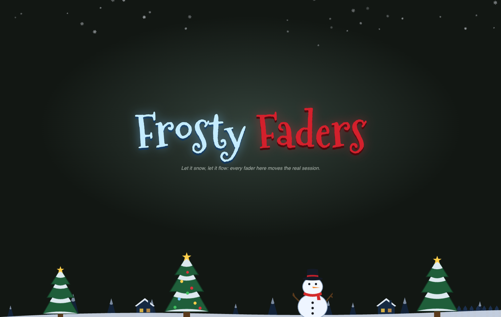
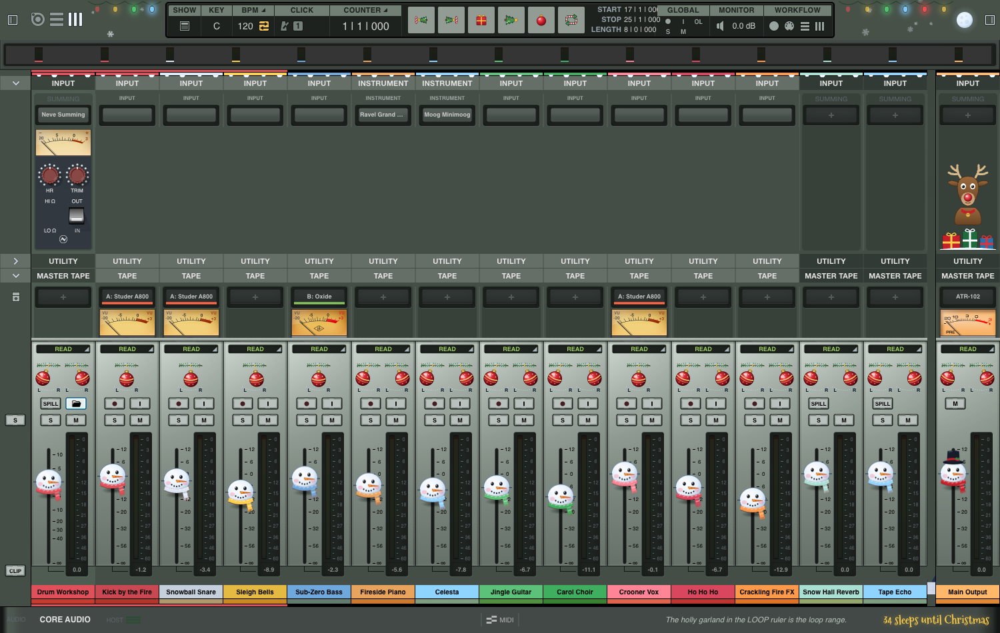

# Frosty Faders

A holiday-themed LUNA Add On. LUNA's Timeline, Mixer, MIDI Editor, Browser and Focus Channel, rebuilt for the season: snowman fader caps, glass-bauble pan knobs, jingle-bell sends, icy thermometer meters, string lights that chase in tempo, and a sleigh across the sky when you press play.

It isn't a skin over a screenshot. Every control edits the session you have open.

## Requirements

- LUNA 3.1.2 or later
- macOS or Windows

## Install

1. Download `frosty-faders.lunaaddon` from the [latest release](../../releases/latest).
2. Double-click it, or drag it onto LUNA's dock icon.
3. Open it from LUNA's **Add Ons** menu.

## Updating

Download the newest release and install it the same way. It replaces the older version.

## Feedback

Found a bug or have an idea? [Open an issue](../../issues).

---

Made by Tyson Yerex. Frosty Faders is a free community Add On and isn't an official Universal Audio product.
